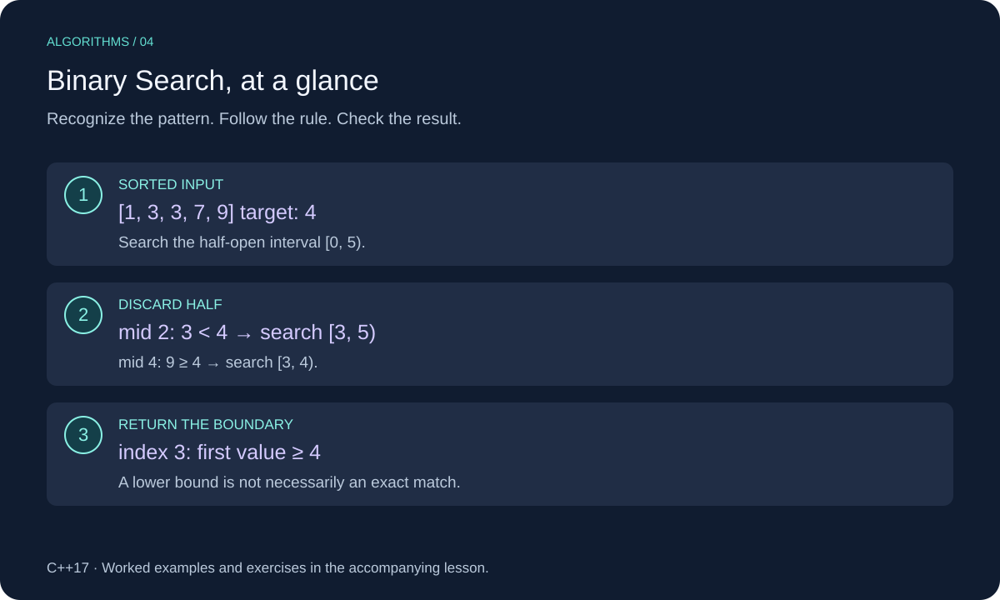

# Binary Search in C++

Binary search repeatedly halves a sorted search range. Each comparison discards a region that cannot contain the answer.



This lesson uses C++17. Review [Arrays](../../01-arrays/cpp_arrays.md) for the underlying structure or technique.

## When to Use It

Use binary search when data is sorted and indexed access is O(1). We will find the **first value greater than or equal to a target**, also called a lower bound. An exact-match lookup then checks that position.

Input must be sorted in nondecreasing order. Duplicate and negative values are allowed. The function does not sort or validate ordering; doing so for every query would hide the logarithmic search cost.

## Worked Example

Find the lower bound of 4 in `[1, 3, 3, 7, 9]`. Keep a half-open range `[left, right)`:

| Left | Right | Mid | Decision |
| --- | --- | --- | --- |
| 0 | 5 | 2, value 3 | Too small: left = 3 |
| 3 | 5 | 4, value 9 | Keep mid as candidate: right = 4 |
| 3 | 4 | 3, value 7 | Keep mid as candidate: right = 3 |

The boundaries meet at 3. Value 7 is the first value at least 4, but an exact match does not exist.

The invariant is: positions before `left` are too small; positions from `right` onward are at least the target. The boundary lies between them. On every iteration, the remaining interval shrinks.

## C++ Implementation

```cpp
#include <cstddef>
#include <iostream>
#include <vector>

std::size_t lower_bound_index(const std::vector<int>& values, int target) {
    std::size_t left = 0;
    std::size_t right = values.size();
    while (left < right) {
        const std::size_t mid = left + (right - left) / 2;
        if (values[mid] < target) {
            left = mid + 1;
        } else {
            right = mid;
        }
    }
    return left;
}

bool contains(const std::vector<int>& values, int target) {
    const auto index = lower_bound_index(values, target);
    return index < values.size() && values[index] == target;
}

int main() {
    const std::vector<int> values = {1, 3, 3, 7, 9};
    std::cout << lower_bound_index(values, 3) << "\n"; // 1
    std::cout << lower_bound_index(values, 4) << "\n"; // 3
    std::cout << std::boolalpha << contains(values, 4) << "\n"; // false
}
```

## Implementation Details

`right` starts at `size()`, an exclusive endpoint; it is never dereferenced. The result can equal `size()` if all values are smaller than the target. Empty input returns index zero.

`left + (right - left) / 2` avoids overflowing the sum of the two boundaries. No `mid - 1` is needed, which also avoids unsigned underflow.

For everyday use, `<algorithm>` provides `std::lower_bound(values.begin(), values.end(), target)` and `std::binary_search`. The manual version makes the boundary rules visible.

## Complexity

O(log n) time for nonempty input and O(1) auxiliary space; empty input takes O(1). Each iteration roughly halves the candidate range.

## Common Mistakes

- Using unsorted input.
- Reading the returned index without checking whether it equals size().
- Mixing inclusive and exclusive right endpoints.
- Setting left to mid instead of mid + 1 when the value is too small; the search may stop making progress.

## Exercises

Try each exercise before opening its solution. Reuse the definitions and headers above; place exercise helpers before `main`.

### Exercise 1: Duplicates

Where is the lower bound of 3 in `[1, 3, 3, 3, 8]`?

<details>
<summary>Show solution</summary>

Index 1. Equality moves the right boundary leftward so earlier equal values remain candidates.

</details>

### Exercise 2: Insertion Position

Find the insertion positions for targets 0 and 10 in `[2, 5, 9]`.

<details>
<summary>Show solution</summary>

The results are 0 and 3. Inserting at either position preserves sorting. Index 3 is a valid insertion boundary, not an existing element.

</details>

### Exercise 3: Upper Bound

Write a helper returning the first index whose value is strictly greater than the target.

<details>
<summary>Show solution</summary>

```cpp
std::size_t upper_bound_index(const std::vector<int>& values, int target) {
    std::size_t left = 0, right = values.size();
    while (left < right) {
        const auto mid = left + (right - left) / 2;
        if (values[mid] <= target) left = mid + 1;
        else right = mid;
    }
    return left;
}
```

For `[1, 3, 3, 3, 8]` and target 3, return 4. Upper bound minus lower bound counts the target's occurrences. O(log n) time, O(1) auxiliary space.

</details>

[Review Arrays](../../01-arrays/cpp_arrays.md)
