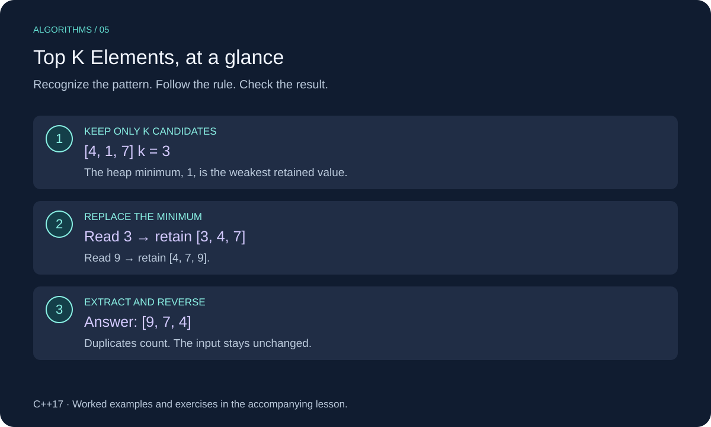

# Top K Elements in C++

To keep the largest `k` values, maintain a small collection of the best candidates seen so far. A min-heap exposes the smallest retained value, making it easy to replace.



This lesson uses C++17. Review [Heaps](../../07-heaps/cpp_heaps.md) for the underlying structure or technique.

## When to Use It

Use a bounded heap when `k` is small compared with the input or when values arrive as a stream. This lesson returns the largest `k` values in descending order. Duplicates count as separate values.

If you need all values sorted, sorting the entire input may be simpler. If “top” means most frequent rather than numerically largest, first count frequencies; that is a different ranking problem.

## Worked Example

For `[4, 1, 7, 3, 9]` and `k = 3`:

| Read | Retained values, shown sorted | Action |
| --- | --- | --- |
| 4 | `[4]` | Fill heap |
| 1 | `[1, 4]` | Fill heap |
| 7 | `[1, 4, 7]` | Fill heap |
| 3 | `[3, 4, 7]` | Replace minimum 1 |
| 9 | `[4, 7, 9]` | Replace minimum 3 |

The answer is `[9, 7, 4]`. The rows show a sorted view for readability; a heap's internal storage is not fully sorted.

After each input value, the heap contains the largest `min(k, values_seen)` values. Once full, a value no larger than its minimum cannot improve the retained group.

## C++ Implementation

```cpp
#include <algorithm>
#include <cstddef>
#include <functional>
#include <iostream>
#include <queue>
#include <stdexcept>
#include <vector>

std::vector<int> top_k_largest(const std::vector<int>& values, std::size_t k) {
    if (k > values.size()) throw std::invalid_argument("k exceeds input size");
    if (k == 0) return {};

    std::priority_queue<int, std::vector<int>, std::greater<int>> best;
    for (int value : values) {
        if (best.size() < k) {
            best.push(value);
        } else if (value > best.top()) {
            best.pop();
            best.push(value);
        }
    }
    std::vector<int> result;
    result.reserve(k);
    while (!best.empty()) {
        result.push_back(best.top());
        best.pop();
    }
    std::reverse(result.begin(), result.end());
    return result;
}

int main() {
    for (int value : top_k_largest({4, 1, 7, 3, 9}, 3)) {
        std::cout << value << " "; // 9 7 4
    }
    std::cout << "\n";
}
```

## Implementation Details

`std::greater<int>` makes the smallest retained value the heap top. Popping yields ascending order; reversing produces the promised descending result.

`k == 0` returns an empty vector, including for empty input. `k > n` throws. Validate signed input before converting to `std::size_t`. The const reference leaves the input unchanged.

## Complexity

For `1 <= k <= n`, O(n log(k + 1)) time including output extraction, and O(k) auxiliary storage plus O(k) output. The `+1` covers `k = 1`, which still scans n values. Vector growth inside the heap is amortized. For `k = 0`, the function returns in O(1).

## Common Mistakes

- Using a max-heap when retaining the largest k; you need quick access to the worst retained candidate.
- Dropping duplicates when they should count.
- Assuming popping a min-heap produces descending order.
- Calling top() before the heap contains any values.

## Exercises

Try each exercise before opening its solution. Reuse the definitions and headers above; place exercise helpers before `main`.

### Exercise 1: Trace Duplicates

What is the result for `[5, 5, 1, 4]` and `k = 2`?

<details>
<summary>Show solution</summary>

`[5, 5]`. Equal values occupy distinct positions and both count.

</details>

### Exercise 2: Kth Largest

Write a helper returning the kth-largest value using the lesson helper. Treat k as one-based.

<details>
<summary>Show solution</summary>

```cpp
int kth_largest(const std::vector<int>& values, std::size_t k) {
    if (k == 0) throw std::invalid_argument("k must be positive");
    return top_k_largest(values, k).back();
}
```

The helper returns the retained values descending, so the final one ranks kth. Oversized k is rejected by `top_k_largest`. This simple reuse has the same time and O(k) storage cost.

</details>

### Exercise 3: Smallest K

How would the heap rule change to retain the smallest k values?

<details>
<summary>Show solution</summary>

Use a max-heap. Once full, replace its maximum only when the new value is smaller. Popping produces descending order; reverse if you want ascending output.

</details>

[Review Heaps](../../07-heaps/cpp_heaps.md)
