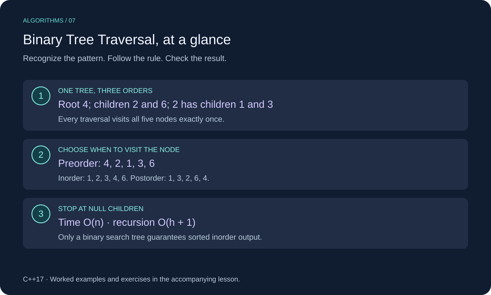

# Binary Tree Traversal in C++

A binary-tree traversal visits each node in a defined order. Preorder, inorder, and postorder differ in when they process a node relative to its two children.



This lesson uses C++17. Review [Trees](../../06-trees/cpp_trees.md) for the underlying structure or technique.

## When to Use It

Use preorder when processing a parent before its children, inorder when walking a binary search tree in sorted order, and postorder when children must be processed before their parent.

These traversals work on any binary tree; only a binary **search** tree guarantees sorted inorder values. The input must be a tree with no cycles and no child shared by multiple parents. For level-by-level order, use breadth-first search.

## Worked Example

```text
        4
       / \
      2   6
     / \
    1   3
```

| Order | Rule | Output |
| --- | --- | --- |
| Preorder | Node, left, right | `4, 2, 1, 3, 6` |
| Inorder | Left, node, right | `1, 2, 3, 4, 6` |
| Postorder | Left, right, node | `1, 3, 2, 6, 4` |

Each recursive call handles one subtree. A null child contributes no value. Moving the output statement changes the order without changing which nodes are visited.

## C++ Implementation

```cpp
#include <iostream>
#include <vector>

struct Node {
    int value;
    Node* left = nullptr;
    Node* right = nullptr;
};

void preorder(const Node* node, std::vector<int>& out) {
    if (node == nullptr) return;
    out.push_back(node->value);
    preorder(node->left, out);
    preorder(node->right, out);
}

void inorder(const Node* node, std::vector<int>& out) {
    if (node == nullptr) return;
    inorder(node->left, out);
    out.push_back(node->value);
    inorder(node->right, out);
}

void postorder(const Node* node, std::vector<int>& out) {
    if (node == nullptr) return;
    postorder(node->left, out);
    postorder(node->right, out);
    out.push_back(node->value);
}

int main() {
    Node one{1}, three{3}, two{2, &one, &three}, six{6};
    Node root{4, &two, &six};
    std::vector<int> result;
    inorder(&root, result);
    for (int value : result) std::cout << value << " "; // 1 2 3 4 6
    std::cout << "\n";
}
```

## Implementation Details

The functions append into a caller-owned output vector. Start with an empty vector or call `clear()` before another traversal if you want a separate result. Nodes are borrowed, not copied or deleted.

The local-node example owns no dynamic memory. In a dynamically allocated tree, a postorder cleanup can release children before their parent, but these printing/collection helpers do not manage ownership. Very deep trees can overflow the call stack; an explicit stack is an alternative.

## Complexity

O(n) time and O(n) output storage. Recursion uses O(h + 1) auxiliary space, where h is height in edges: O(log n) for a balanced tree and O(n) for a chain. A null root takes constant time and appends nothing.

## Common Mistakes

- Claiming inorder is sorted for every binary tree.
- Omitting the null base case.
- Reusing a nonempty output vector unintentionally.
- Calling recursion O(1) space; pending calls occupy stack space.

## Exercises

Try each exercise before opening its solution. Reuse the definitions and headers above; place exercise helpers before `main`.

### Exercise 1: Trace an Uneven Tree

For root 1 with only right child 2, give all three traversal orders.

<details>
<summary>Show solution</summary>

Preorder: `1, 2`. Inorder: `1, 2`. Postorder: `2, 1`. Different orders can produce identical results on some shapes.

</details>

### Exercise 2: Count Leaves

Write a helper counting nodes with neither child.

<details>
<summary>Show solution</summary>

```cpp
std::size_t count_leaves(const Node* node) {
    if (node == nullptr) return 0;
    if (node->left == nullptr && node->right == nullptr) return 1;
    return count_leaves(node->left) + count_leaves(node->right);
}
```

Include `<cstddef>` for `std::size_t`. The worked tree has three leaves: 1, 3, and 6. O(n) time and O(h + 1) recursion space. Assume the count fits in the size type.

</details>

### Exercise 3: Sorted or Not?

Root 2 has left child 9 and right child 1. Is inorder sorted?

<details>
<summary>Show solution</summary>

No. Inorder is `9, 2, 1`. The traversal is correct, but this tree does not satisfy the binary-search-tree ordering rule.

</details>

[Review Trees](../../06-trees/cpp_trees.md)
