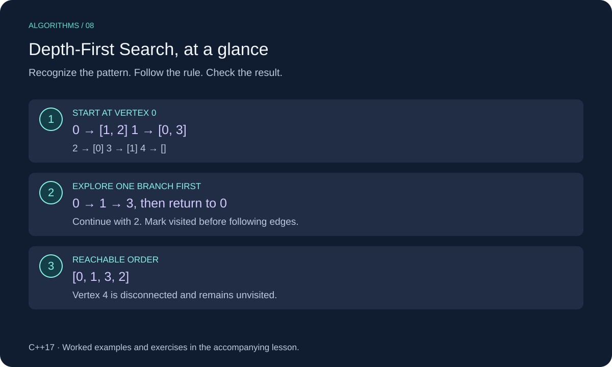

# Depth-First Search (DFS) in C++

Depth-first search follows one branch as far as possible before returning to explore another. A visited set prevents revisiting vertices in a graph with cycles.



This lesson uses C++17. Review [Graphs](../../08-graphs/cpp_graphs.md) for the underlying structure or technique.

## When to Use It

Use DFS to explore reachability, inspect connected regions, or process dependencies with an appropriate ordering rule. This lesson returns vertices reachable from one start in visitation order.

We use adjacency lists with vertex IDs from zero through `graph.size() - 1`. Lists can represent directed or undirected edges. For an undirected graph, store each edge at both endpoints. DFS visitation order is not generally a shortest path.

## Worked Example

For these neighbor lists, process neighbors in the listed order:

```text
0: [1, 2]
1: [0, 3]
2: [0]
3: [1]
4: []
```

Starting at 0: visit 0, follow 1, follow 3, return to 1, return to 0, then follow 2. The order is `[0, 1, 3, 2]`. Vertex 4 is unreachable from 0 and is not returned.

Mark a vertex before following its neighbors. For edge `1 → 0`, the visited flag prevents recursing back into the active root.

## C++ Implementation

```cpp
#include <cstddef>
#include <iostream>
#include <stdexcept>
#include <vector>

using Graph = std::vector<std::vector<std::size_t>>;

void validate_graph(const Graph& graph) {
    for (const auto& neighbors : graph) {
        for (auto next : neighbors) {
            if (next >= graph.size()) throw std::out_of_range("Invalid neighbor");
        }
    }
}

void dfs_visit(const Graph& graph, std::size_t vertex,
               std::vector<bool>& visited, std::vector<std::size_t>& order) {
    visited[vertex] = true;
    order.push_back(vertex);
    for (auto next : graph[vertex]) {
        if (!visited[next]) dfs_visit(graph, next, visited, order);
    }
}

std::vector<std::size_t> dfs(const Graph& graph, std::size_t start) {
    if (start >= graph.size()) throw std::out_of_range("Invalid start");
    validate_graph(graph);
    std::vector<bool> visited(graph.size(), false);
    std::vector<std::size_t> order;
    dfs_visit(graph, start, visited, order);
    return order;
}

int main() {
    const Graph graph = {{1, 2}, {0, 3}, {0}, {1}, {}};
    for (auto vertex : dfs(graph, 0)) std::cout << vertex << " "; // 0 1 3 2
    std::cout << "\n";
}
```

## Implementation Details

`dfs` validates all neighbor IDs before recursion. An empty graph has no valid start and throws. Self-loops and duplicate adjacency entries are safe because visited vertices are skipped, although scanning duplicate entries still takes work.

`dfs_visit` is an internal helper: call it only with valid IDs and a correctly sized visited vector. Recursion can be as deep as the number of reachable vertices. Use an iterative implementation for graphs deep enough to risk call-stack exhaustion.

## Complexity

O(V + E) time including full validation and visited-vector initialization; E counts adjacency entries (twice the edge count for a usual undirected representation). The traversal itself explores only reachable vertices and their lists. Auxiliary space is O(V), including visited flags and recursion; output is O(V) in the worst case.

## Common Mistakes

- Marking visited only after recursive calls, allowing a cycle to recurse forever.
- Assuming a single start covers disconnected vertices.
- Treating DFS order as a shortest path.
- Expecting a unique visitation order regardless of neighbor ordering.

## Exercises

Try each exercise before opening its solution. Reuse the definitions and headers above; place exercise helpers before `main`.

### Exercise 1: A Directed Cycle

What does DFS from 0 return for `[[1], [2], [0]]`?

<details>
<summary>Show solution</summary>

`[0, 1, 2]`. Vertex 0 is already marked when 2 examines its link back to 0. Each vertex is visited once.

</details>

### Exercise 2: Reachability

Write a helper checking whether target is reachable from start using `dfs`.

<details>
<summary>Show solution</summary>

```cpp
bool reachable(const Graph& graph, std::size_t start, std::size_t target) {
    if (target >= graph.size()) throw std::out_of_range("Invalid target");
    for (auto vertex : dfs(graph, start)) {
        if (vertex == target) return true;
    }
    return false;
}
```

A valid start reaches itself even without edges. This simple reuse builds the entire visitation order before checking it. O(V + E) time and O(V) space.

</details>

### Exercise 3: Disconnected Coverage

How can you visit every vertex, including isolated ones?

<details>
<summary>Show solution</summary>

Keep one shared visited vector. Loop through every vertex and call the DFS helper whenever it is still unvisited. For an undirected graph, each new traversal identifies another connected component. For a directed graph, this does not count strongly connected components.

</details>

[Review Graphs](../../08-graphs/cpp_graphs.md)
