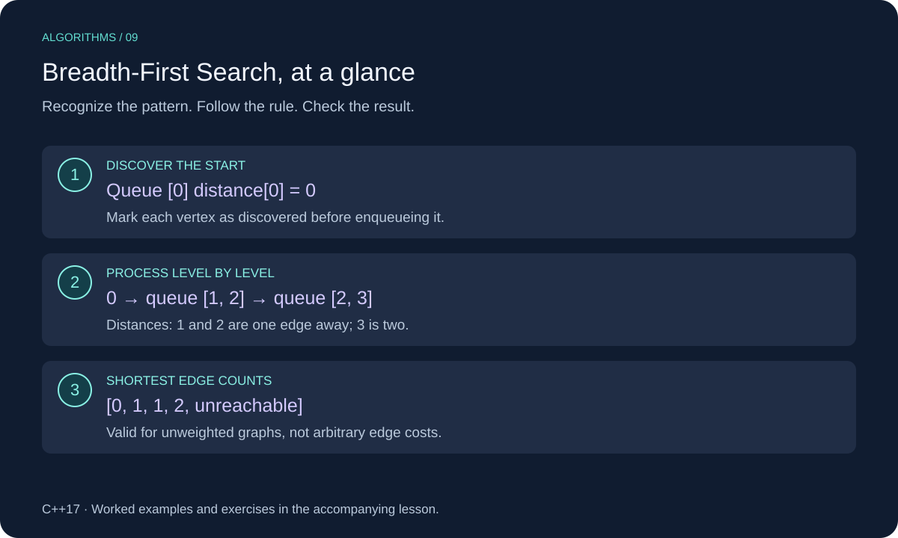

# Breadth-First Search (BFS) in C++

Breadth-first search explores a graph one distance level at a time. A FIFO queue ensures that nearer vertices are processed before farther ones.



This lesson uses C++17. Review [Queues](../../04-queues/cpp_queues.md) for the underlying structure or technique.

## When to Use It

Use BFS to find the fewest edges from a start vertex in an unweighted graph, or when every edge has the same positive cost. It also gives level-order traversal of a tree.

This lesson returns shortest edge counts for every vertex. It does not return the paths themselves. For varying edge weights, ordinary BFS does not generally give minimum-cost paths.

## Worked Example

Use the same graph as the DFS lesson:

```text
0: [1, 2]
1: [0, 3]
2: [0]
3: [1]
4: []
```

| Process | Newly discovered | Queue afterward |
| --- | --- | --- |
| Start | 0 at distance 0 | `[0]` |
| 0 | 1 and 2 at distance 1 | `[1, 2]` |
| 1 | 3 at distance 2 | `[2, 3]` |
| 2 | None | `[3]` |
| 3 | None | `[]` |

Distances are `[0, 1, 1, 2, unreachable]`. The first discovery of a vertex gives its shortest distance because all shorter distance levels have already been discovered.

## C++ Implementation

```cpp
#include <cstddef>
#include <iostream>
#include <optional>
#include <queue>
#include <stdexcept>
#include <vector>

using Graph = std::vector<std::vector<std::size_t>>;

std::vector<std::optional<std::size_t>> bfs_distances(
    const Graph& graph, std::size_t start) {
    if (start >= graph.size()) throw std::out_of_range("Invalid start");
    for (const auto& neighbors : graph) {
        for (auto next : neighbors) {
            if (next >= graph.size()) throw std::out_of_range("Invalid neighbor");
        }
    }

    std::vector<std::optional<std::size_t>> distance(graph.size());
    std::queue<std::size_t> pending;
    distance[start] = 0;
    pending.push(start);
    while (!pending.empty()) {
        const auto vertex = pending.front();
        pending.pop();
        for (auto next : graph[vertex]) {
            if (!distance[next].has_value()) {
                distance[next] = *distance[vertex] + 1;
                pending.push(next);
            }
        }
    }
    return distance;
}

int main() {
    const Graph graph = {{1, 2}, {0, 3}, {0}, {1}, {}};
    for (const auto& distance : bfs_distances(graph, 0)) {
        if (distance) std::cout << *distance << " ";
        else std::cout << "unreachable ";
    }
    std::cout << "\n"; // 0 1 1 2 unreachable
}
```

## Implementation Details

A disengaged optional means undiscovered or unreachable; a stored zero is the valid distance to the start. Checking an optional's presence does not test whether its value is nonzero.

Mark discovery by setting the distance **before enqueueing**, so a vertex enters the queue at most once even when several edges lead to it. Self-loops and duplicate edges are safe. The graph uses IDs from zero through size minus one; an empty graph has no valid start.

Neighbor order can change which shortest path is discovered first, but it cannot change shortest distances.

## Complexity

O(V + E) time including input validation and distance initialization, where E counts adjacency entries. The queue uses O(V) auxiliary space and the returned distances use O(V) storage. Each reachable vertex enters the queue once.

## Common Mistakes

- Using a stack instead of a queue.
- Marking discovered only when dequeuing, allowing duplicate enqueues.
- Using zero as the marker for unreachable vertices.
- Applying unweighted BFS distances to unequal edge costs.

## Exercises

Try each exercise before opening its solution. Reuse the definitions and headers above; place exercise helpers before `main`.

### Exercise 1: Two Equal Routes

For `[[1, 2], [3], [3], []]`, what is the distance from 0 to 3?

<details>
<summary>Show solution</summary>

It is 2, via either 1 or 2. Vertex 3 is enqueued once, when first discovered.

</details>

### Exercise 2: Distance to One Target

Write a helper returning only the optional distance from start to target.

<details>
<summary>Show solution</summary>

```cpp
std::optional<std::size_t> shortest_distance(const Graph& graph,
                                            std::size_t start,
                                            std::size_t target) {
    if (target >= graph.size()) throw std::out_of_range("Invalid target");
    return bfs_distances(graph, start)[target];
}
```

An unreachable target returns an empty optional. This version computes all distances, taking O(V + E) time and O(V) space.

</details>

### Exercise 3: Recover a Path

What extra information would let you recover an actual shortest path?

<details>
<summary>Show solution</summary>

When discovering a vertex, store the vertex that discovered it as its parent. Follow parent links backward from a reachable target to the start, then reverse that sequence. Set each parent only on first discovery; do not try to recover a path for an unreachable target.

</details>

[Review Queues](../../04-queues/cpp_queues.md)
