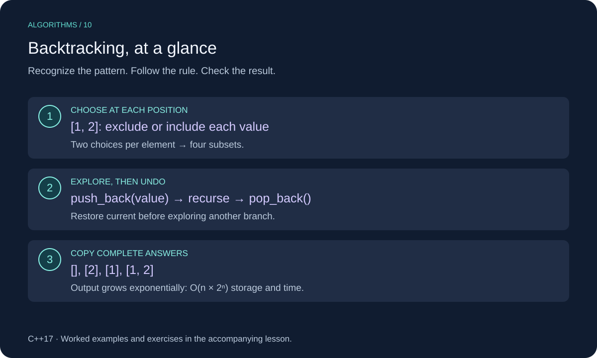

# Backtracking in C++

Backtracking builds a candidate one choice at a time, explores what follows, then undoes that choice before trying another. It is useful when you must enumerate combinations or search a space of valid candidates.



This lesson uses C++17. Review [Depth-First Search](../../algorithms/08-depth_first_search_dfs/cpp_depth_first_search_dfs.md) for the underlying structure or technique.

## When to Use It

Use backtracking for subsets, combinations, arrangements, and constraint problems. The core pattern is **choose → explore → undo**. When a partial choice already violates a constraint, pruning can stop that branch early.

This lesson generates all subsets of a small input with distinct values. There are exponentially many answers, so backtracking is not a way to make large exhaustive searches cheap. The example has no constraints to prune.

## Worked Example

For `[1, 2]`, at each position choose to exclude or include its value:

```text
start []
├─ exclude 1
│  ├─ exclude 2 → []
│  └─ include 2 → [2]
└─ include 1
   ├─ exclude 2 → [1]
   └─ include 2 → [1, 2]
```

At index 2, all choices are made, so copy the current subset into the result. After exploring an include branch, remove its last value. The invariant is that `current` contains exactly the selected values from positions before `index`.

The exclude branch comes first in this implementation, so the returned order is `[], [2], [1], [1, 2]`. Other consistent branch orders are equally valid.

## C++ Implementation

```cpp
#include <cstddef>
#include <iostream>
#include <vector>

void collect_subsets(const std::vector<int>& values, std::size_t index,
                     std::vector<int>& current,
                     std::vector<std::vector<int>>& result) {
    if (index == values.size()) {
        result.push_back(current);
        return;
    }

    collect_subsets(values, index + 1, current, result); // Exclude
    current.push_back(values[index]);                  // Choose
    collect_subsets(values, index + 1, current, result); // Explore
    current.pop_back();                               // Undo
}

std::vector<std::vector<int>> subsets(const std::vector<int>& values) {
    std::vector<int> current;
    std::vector<std::vector<int>> result;
    collect_subsets(values, 0, current, result);
    return result;
}

int main() {
    for (const auto& subset : subsets({1, 2})) {
        std::cout << "[";
        for (int value : subset) std::cout << value << " ";
        std::cout << "]\n";
    }
}
```

## Implementation Details

`current` is passed by reference so one working vector is reused. `result.push_back(current)` stores a copy: later undo steps must not change completed answers. The input is read through a const reference.

The recursion always advances `index`, so it terminates. Empty input returns one subset, the empty subset, not zero subsets. Distinct values are a precondition for unique value-subsets. Duplicate inputs still enumerate position choices, but can produce repeated value-subsets.

Both output size and recursion depth limit practical input sizes. An iterative version can avoid recursive calls, but cannot avoid the cost of returning exponentially many answers.

## Complexity

There are 2ⁿ subsets. Copying them takes O(n × 2ⁿ) time and output storage for nonempty inputs; recursion and the current subset use O(n) auxiliary space. Empty input takes O(1). The recursion tree itself has O(2ⁿ) calls, but copying answers adds the factor n.

## Common Mistakes

- Forgetting to undo a choice before exploring a sibling branch.
- Saving a reference to the mutable current vector instead of a copy.
- Missing the base-case return.
- Claiming polynomial complexity because each individual choice is simple.

## Exercises

Try each exercise before opening its solution. Reuse the definitions and headers above; place exercise helpers before `main`.

### Exercise 1: Trace Three Values

How many subsets does `[1, 2, 3]` produce? What about empty input?

<details>
<summary>Show solution</summary>

Eight subsets for three distinct values, and one empty subset for empty input. Each element independently has two choices.

</details>

### Exercise 2: Keep Subsets of Size K

Write a helper using `subsets` to keep only answers of size k.

<details>
<summary>Show solution</summary>

```cpp
std::vector<std::vector<int>> subsets_of_size(const std::vector<int>& values,
                                             std::size_t k) {
    if (k > values.size()) return {};
    std::vector<std::vector<int>> result;
    for (const auto& subset : subsets(values)) {
        if (subset.size() == k) result.push_back(subset);
    }
    return result;
}
```

For `[1, 2, 3]`, k = 2 gives `[2, 3]`, `[1, 3]`, `[1, 2]` in this branch order. This simple version still builds all subsets: O(n × 2ⁿ) time and temporary storage. It is not a pruned search.

</details>

### Exercise 3: Prune the Size-K Search

How could a direct size-k backtracking search avoid impossible branches?

<details>
<summary>Show solution</summary>

Stop a branch when the current size exceeds k or when current size plus remaining elements is less than k. Once the current size is k, record it and stop extending that branch. Pruning saves work but still must produce every requested combination.

</details>

[Review Depth-First Search](../../algorithms/08-depth_first_search_dfs/cpp_depth_first_search_dfs.md)
